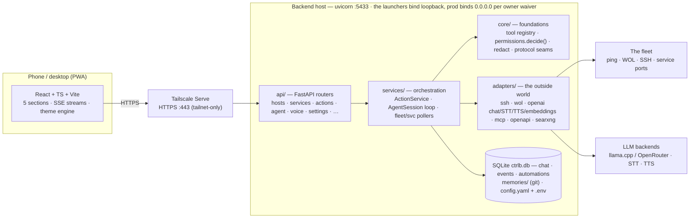

# ctrl-b

**Easy control over your fleet.** A single-user homelab control panel for waking, monitoring, and
managing a personal fleet of PCs over LAN + Tailscale — driven from a phone-first web app or a
tool-using **LLM agent** (text or voice) that executes **typed, allowlisted actions** instead of
raw shell.

<table align="center"><tr><td>
<video src="https://github.com/user-attachments/assets/56b07460-1b58-47ea-aff3-6f06514aae74" controls muted></video>
</td></tr></table>

[](https://github.com/nengoxx/ctrl-b/actions/workflows/ci.yml)
[](./LICENSE)

> **v1.0** — a ground-up rewrite (React + TypeScript + Vite PWA · FastAPI + Uvicorn). The earlier
> hand-built Flask dashboard lives in [`archive/v0.1-flask/`](./archive/v0.1-flask/). *(Internal dev
> docs call this rewrite "v2"/"dashboard_v2" — the development name for what ships as v1.0.)*

---

## Contents

- [What it does](#what-it-does)
- [Using ctrl-b](#using-ctrl-b)
- [Architecture](#architecture)
- [Design principles & patterns](#design-principles--patterns)
- [Security model](#security-model)
- [Quickstart](#quickstart)
- [Deploying as a server](#deploying-as-a-server)
- [Configuration](#configuration)
- [Quality harness](#quality-harness)
- [Repository layout](#repository-layout)
- [Developer docs](#developer-docs)

## What it does

Five sections, one shared chat composer (on Fleet and Chat, with a push-to-talk mic + auto-TTS),
installable as a PWA over HTTPS. Phone-first (~390 px), widens gracefully to desktop. How many sections
sit on the bottom bar depends on the theme and on Conf → Appearance → **Layout** (kept per device); the
others open from the nav menu or live as a group inside Conf.

| Section | What lives there |
|---|---|
| **[Fleet](docs/user-guide/fleet.md)** | Live host cards (ping/online state, per-host **services** with TCP-probed liveness and a link while a service is up), wake-on-LAN, shutdown/reboot (which power buttons a card shows depends on the theme), expandable detail rows. Risky actions confirm before firing. Starting, stopping and restarting a service are **agent** tools, not buttons. |
| **[Chat](docs/user-guide/chat.md)** | A tool-calling LLM chat wired to the same action registry the UI uses. Confirm bubbles for gated calls, a live **plan panel** (TodoWrite-style checklist), markdown replies with copy / send-to-composer, per-message provider switching (`/<provider>`), context **compaction** for long threads, **conversations per agent** (each agent keeps its own list, with a live status per conversation — D84), **attachments** (images/text/PDFs the agent can re-read). |
| **[Tools](docs/user-guide/tools.md)** | One-shot utility tools (DNS resolve, IP lookup, YouTube captions) — the same registry, UI-exposed — plus the catalog of the agent's tools. On a 3-tab layout (frontier and gacha by default) it is a group inside Conf. |
| **[Agents](docs/user-guide/agents.md)** | The agent gallery. An agent is a folder (`agent.yaml` + `SOUL.md`); **[characters](docs/user-guide/characters-and-lorebooks.md)** are agents with imported V1, V2 and V3 cards and lorebooks. By default a group inside Conf; Conf → Appearance → Agents makes it a nav button or a bar tab. |
| **[Conf](docs/user-guide/conf.md)** | Most of `config.yaml` from the UI: computers & services, providers, inference/voice endpoints, integrations (MCP / OpenAPI / SearXNG / embeddings / open-terminal), skills, per-tool overrides, prompts, the memory panel, **[scheduled automations](docs/user-guide/automations.md)** (cron-driven agent runs with run history, D49), the **[media manager](docs/user-guide/media.md)** (upload · crop · focal point · per-destination art libraries, D65), notifications, **[Appearance](docs/user-guide/themes.md)**, and the HTTPS (Tailscale Serve) card at the foot of Conf → Server. A few keys are YAML-only ([the configuration reference](docs/user-guide/configuration-reference.md) says which). |

**The agent** speaks to any OpenAI-compatible backend — local `llama.cpp` or a cloud router — and
sees the action registry as OpenAI `tools`. It also gets: file-discovered **skills** (auto-narrowing
toolsets that make weak local models reliable), **subagents** (bounded parallel delegation),
**web search** (SearXNG), tools from **MCP servers** (Streamable HTTP + stdio) and **OpenAPI/REST
tool servers**, durable **memory** (git-backed markdown, D26), and **[voice](docs/user-guide/voice-and-calls.md)**
via OpenAI-compatible STT/TTS — a hold-to-record mic, chunked read-along playback, and a hands-free
**call mode** (on by default since v1.7.8, once a realtime ear is configured), with optional
phrase-by-phrase **streaming dictation** (ships off). Both ride the app's one WebSocket, media ingress
only. Multiple **agent definitions** (model + prompt + tools + privilege) live as folders under
`$CTRLB_HOME/agents/`; `agent.default_agent` picks who a new conversation starts with (blank = the root agent).

**[Themes](docs/user-guide/themes.md)**: a pluggable presentation layer — five themes (**cosmos** the
default · vapor · minimal · frontier · gacha) — swap the whole look from Conf → Appearance; the theme and
most appearance settings sync across devices, the bar layout and placement stay per device.

## Using ctrl-b

The **user guide** lives in [`docs/user-guide/`](docs/user-guide/README.md): what you see and tap, what
each setting does, and the edge cases — one page per surface.

| Page | What |
|---|---|
| [User guide index](docs/user-guide/README.md) | Start here: what ctrl-b is for and where everything is |
| [Getting started](docs/user-guide/getting-started.md) | First run, opening it on your phone, installing the PWA, HTTPS for the mic, the five sections, what needs a restart |
| [Fleet](docs/user-guide/fleet.md) | Host cards, wake / shut down / reboot and the confirm flow, what each host field enables, services, the monitor + notifications, the event log (read through the API; there is no in-app list), the `!` local shell, open-terminal |
| [Chat](docs/user-guide/chat.md) | The composer and every command, attachments, conversations per agent, auto-speak, the agent's tools and privilege levels, memory, compaction, the providers chain, MCP + OpenAPI tool servers |
| [Voice & calls](docs/user-guide/voice-and-calls.md) | The mic and its gestures, dictation, sending a clip, call mode and the in-call deck, barge-in, auto-speak, what survives a locked phone, TTS, the limits |
| [Agents](docs/user-guide/agents.md) | Agents as folders, the gallery and editors, the root agent and specialists, skills, subagents, macros, per-agent model and privilege, the persona library |
| [Characters & lorebooks](docs/user-guide/characters-and-lorebooks.md) | V1, V2 and V3 card import, card export, what a character is here, lorebook activation, the lorebook editor |
| [Media](docs/user-guide/media.md) | Your own art: the gallery + media manager, libraries per destination, upload limits, crop + focal point, reorder, which image is live |
| [Themes](docs/user-guide/themes.md) | The theme catalog, Appearance switches, composer skins, what syncs vs stays per device, PWA install/update/offline |
| [Tools](docs/user-guide/tools.md) | The one-shot utilities + the agent tool catalog |
| [Conf](docs/user-guide/conf.md) | The Conf tab section by section, the save model, live vs restart, the HTTPS card, backups |
| [Automations](docs/user-guide/automations.md) | Scheduled agent runs: creating one, the schedule syntax, headless runs, privilege, where results land |
| [Configuration reference](docs/user-guide/configuration-reference.md) | Every `config.yaml` key: type, default, what it does, when a change applies |
| [Troubleshooting](docs/user-guide/troubleshooting.md) | Symptom → cause → fix, plus the known limits |

## Architecture



**Backend layers** (`backend/app/`) — dependencies point downward only; `core/` never imports
`services/` (enforced by a test):

| Layer | Contents | Role |
|---|---|---|
| `api/` | one router per resource | HTTP/SSE surface; thin — no business logic |
| `services/` | `action_service.py`, `agent/` (session loop, subagents, memory, compaction), `automations/` (cron scheduler + headless runs, D49), `monitor.py`, `fleet.py`, `svc.py`, `actions/`, `tools/` | orchestration: the permission gate, the agent turn loop, concurrent fleet polling with TTL caches, scheduled runs |
| `core/` | `tool.py` (registry), `permissions.py`, `redact.py`, `skills.py`, `memory.py`, `events.py` | dependency floor: the registry, the pure `decide()` gate, secret redaction, pluggable Protocol seams |
| `adapters/` | `ssh.py`, `wol.py`, `inference.py`, `voice.py`, `mcp_client.py`, `openapi_tools.py`, `searxng.py`, `embeddings.py`, `openterminal.py` | every external system behind one construction site each (rewireable live via `runtime.reconfigure`) |
| `domain/` | enums (`Risk`, `Privilege`, `OSType`), host/service/conversation/plan models | shared typed vocabulary |

**One execution path.** Every action — a Fleet button, an agent tool call, a Tools-section tool, an MCP
tool — flows through the same chain: **registry → `permissions.decide()` → `ActionService` →
adapter**, and every invocation is recorded as an `Event`. There is no second path to side-step.

**The agent loop** (`services/agent/session.py`) streams SSE events (`text.delta`, `part.added`,
`tool.permission`, `compaction`, …) per turn: assemble context (compacting old turns past a token
threshold) → call the model with the aggregated toolset → run ALLOW calls → **suspend** on a
CONFIRM call (persisted `AWAITING_CONFIRM`, rendered as a command bubble; execute/dismiss resumes
the stream — survives restarts and token expiry) → loop until text-only. Skills can narrow the
toolset per turn; subagents delegate scoped tasks depth-capped and privilege-clamped.

**Frontend** (`frontend/src/`): React 19 + TanStack Query for server state, a dep-free
`createStore` for UI state, hand-rolled markdown, and a **theme engine** — semantic design tokens +
a headless-controller **Kit**, with three integration bands per region: *tokens only* → *Surface*
(headless controller + theme-owned view; Fleet today) → *bespoke* (vapor, the reference design).
Themes are lazy `React.lazy` roots switched with View Transitions; appearance state syncs
cross-device through the backend (last-write-wins).

## Design principles & patterns

| Principle | Concretely |
|---|---|
| **Typed actions over raw shell** | Execution = named, allowlisted registry entries with Pydantic inputs, declared `risk` + `confirm`. Raw shell exists but is an off-by-default, gated escape hatch. |
| **Policy as data** | `decide(spec, privilege) → ALLOW / CONFIRM / DENY` is one pure function over declared risk — not `if`s scattered per call site. |
| **One chokepoint per concern** | Config writes: `edit_config_yaml` (comment-preserving, secret round-trip). Output: `redact()` before anything leaves the process. Quality: `tools/check.py`. OS-specifics: a closed, test-pinned allowlist. |
| **Config = human-owned YAML** | `config.yaml` is the source of truth, UI-edited via masked read / unmask-on-write round-trips that never clobber a stored secret or a hand-written comment. `.env` overrides any declared scalar (`CTRLB_<SECTION>__<KEY>`). |
| **Extend, don't migrate** | Growing dimensions live in one per-item object extended with optional fields (e.g. `tool_overrides: {tool: {description, agent_mode}}`) — never parallel name-keyed sibling maps. |
| **Pluggable via Protocols** | Skills provider/selector, memory provider/backup, subagent orchestrator — one consistent seam shape; defaults are file-based and stateless (live-editable). |
| **Decisions are written down** | Every locked architectural choice is a numbered entry in [`docs/DECISIONS.md`](./docs/DECISIONS.md), and load-bearing invariants are pinned by **drift-guard tests** named for them (`test_memory_registry_d27.py`, `test_arch_invariants_qh9.py`, …) so docs can't silently rot. |
| **OS-agnostic by construction** | What runs ON a managed host (shutdown/reboot syntax, service commands) keys off `host.os_type`, never the server's OS — a Linux server managing a Windows box is the same code path as the reverse. The few server-OS branches (the ping syntax, the local shell) are a closed allowlist pinned by `test_arch_invariants_qh9.py`. |

## Security model

Full model: [`docs/SECURITY_MODEL.md`](./docs/SECURITY_MODEL.md). The short version:

- **The tailnet is the auth.** Single user, no login. The listen address comes from the uvicorn
  command line, not from `config.yaml`: the shipped launchers bind the backend to loopback (`127.0.0.1:5433`;
  the dev unit `127.0.0.1:5434`) — but their dev modes also start Vite on `0.0.0.0:5173`, which proxies the
  whole API to the LAN over plain HTTP while it runs — and the **deployed prod service binds `0.0.0.0:5433`** under a documented owner
  waiver (2026-07-10 — trusted home LAN + tailnet, never a public interface;
  [`SECURITY_MODEL.md`](./docs/SECURITY_MODEL.md) §2.1). `server.host` / `server.port` bind nothing: `port` only
  changes what `/api/health` reports, and nothing reads `host` ([ISS-91](./docs/ISSUES.md)). Either way the remote ingress is
  **Tailscale Serve** HTTPS (never Funnel — nothing public, by construction).
- **Confirm gates, not auth.** Medium/high-risk actions suspend into an explicit confirm step
  (single-use, TTL'd tokens bound to the exact call) — a UX safety, deliberately not a security
  boundary. `ui_exposed` decides what the UI lists, not what can be called: `POST /api/actions/{name}`
  reaches every registered tool — the Tailscale Serve actions and `run_shell` included — behind that
  confirm token ([ISS-88](./docs/ISSUES.md)).
- **Secrets never leave.** SSH passwords / API keys live in gitignored `config.yaml`/`.env`, are
  masked on API read, redacted from the output of the commands ctrl-b runs (the local shell, the SSH
  power and service commands — open-terminal's output is not passed through the redactor), and locked
  by tests (`test_secret_hygiene.py`).
- **Shell is opt-in RCE.** The `!` composer escape hatch (`shell.user_exec_enabled`) and the agent's
  `run_shell` (`shell.agent_exec_enabled`) are two independent off-by-default toggles. The agent toggle
  governs agents at `confirm`/`auto_low`: off → `run_shell` is denied, on → every call asks first (`readonly`
  is denied either way). An agent running at `full` (by its `agent.yaml`, or your per-device `/privilege full`) runs `run_shell`
  with **no confirm whether the toggle is on or off** — the only off-switch at `full` is
  `shell.enabled: false` ([ISS-87](./docs/ISSUES.md)).

## Quickstart

Config is optional (built-in defaults apply). To set hosts / endpoints / secrets, copy
`config.example.yaml` → `config.yaml` **in the data root** (`$CTRLB_HOME` — the repo root by default,
`~/.ctrl-b` on a server) and, if you want env overrides, `.env.example` → `.env` (always in the repo
root). Both are gitignored. `ctrlb.db` is created on first run. [Getting started](docs/user-guide/getting-started.md)
walks through the first run and opening it on your phone.

**Windows (double-click):**
```
deploy\windows\setup.cmd     # once: backend venv (Python 3.14) + deps + frontend build
deploy\windows\start.cmd     # PROD on http://127.0.0.1:5433   (-Dev / -Tailscale / -Build)
```

**Linux/macOS (manual, no systemd):**
```bash
deploy/linux/run.sh prod     # build + uvicorn :5433 serving the dist
deploy/linux/run.sh dev      # uvicorn :5433 (--reload) + Vite :5173 HMR
```

**From source, by hand** (a full clone with its tags — the version comes from `git describe`, so a
shallow or tagless clone fails `pip install -e`):
```bash
cd backend && python3 -m venv .venv && .venv/bin/pip install -e ".[dev,voice]"   # Windows: .venv\Scripts\python.exe
# [dev] = the tools/check.py toolchain (ruff/pyright/pytest) — needed to commit; [voice] = onnxruntime/numpy/av.
# Without [voice] the app still boots, but STT reports unconfigured: no mic button, and so no call button
cd ../frontend && npm install && npm run build     # the UI :5433 serves — found once, at startup
cd ../backend && .venv/bin/uvicorn app.main:app --port 5433 --ws-ping-interval 5 --ws-ping-timeout 5   # http://127.0.0.1:5433
# optional, hot reload in a second terminal:  cd frontend && npm run dev   → http://localhost:5173 (proxies /api → 5433)
```

Requirements: **Python 3.14+** (the code uses 3.14-only syntax) · **Node ^20.19 or ≥ 22.12** (Vite 7's
floor; CI runs Node 24). The two `--ws-*` flags are what every shipped launcher passes: without them
uvicorn's 20 s / 20 s default takes ~40 s to notice a dead phone socket, and a redialled call is refused
as busy until then. Without `npm run build`, `:5433` serves only `/api` (and `/` answers
`{"detail":"Not Found"}`); a first build after the server started needs a restart. For the mic (and phone
use generally) front the app with HTTPS: `tailscale serve --bg --https=443 5433`
([`docs/HTTPS_TAILSCALE.md`](./docs/HTTPS_TAILSCALE.md)).

> **Windows + `--reload` gotcha.** Don't run the backend with `--reload` on Windows — uvicorn's
> reload worker uses an event loop that breaks `asyncio.create_subprocess_exec`, so pings return
> empty and every host shows offline. Linux/macOS are unaffected.

## Deploying as a server

**Linux (systemd, always-on + HTTPS)** — the production shape. One command from a configured
checkout drives the whole first deploy over SSH (it needs paramiko + PyYAML, which the backend venv has):

```bash
backend/.venv/bin/python deploy/bootstrap.py            # PROD only: prereqs → SFTP config.yaml → prod tree → install.sh prod → Tailscale HTTPS
backend/.venv/bin/python deploy/bootstrap.py --with-dev # also the DEV workspace + install.sh dev (the dev instance + the agent units)
backend/.venv/bin/python deploy/bootstrap.py --dry-run  # print the plan, change nothing
```

`bootstrap.py` is the **first-deploy** tool: re-run on a deployed box, it checks out the newest `v*`
tag and installs it without `update.sh`'s safety checks ([ISS-94](./docs/ISSUES.md)) — to move a
deployed prod, follow the runbook's §Release.

With `--with-dev` it sets up the **two-instance topology** ([`docs/DECISIONS.md`](./docs/DECISIONS.md) D32, amended
2026-07-09 — trunk-based): PROD = a clean sparse runtime clone at `~/apps/ctrl-b` pinned to a
release **tag**, its own data dir (`~/.ctrl-b`), uvicorn :5433 behind Tailscale Serve :443; DEV =
the workspace (a full checkout on `main` — the only branch) with isolated data (`~/.ctrl-b-dev`,
backend :5434 + Vite :5173). `deploy/linux/install.sh [prod|dev]` is idempotent per instance,
snapshots the prod DB before cutover (keeping the newest 10 — the prune also deletes hand-made
snapshots named `ctrlb-*`, [ISS-93](./docs/ISSUES.md)), and renders the systemd user units. Full runbook:
[`deploy/linux/README.md`](./deploy/linux/README.md).

**Windows (auto-start):** `deploy\windows\autostart-enable.cmd` registers a logon task
(`-Tailscale` re-applies HTTPS at logon too).

**On-box Claude Code agents (tmux):** `install.sh dev` also boots two always-on agent services in the
workspace — `ctrl-b-agent@fable` (`claude-fable-5-1` — **the main model**: designs, supervises, rules,
audits) and `ctrl-b-agent@opus` (`claude-opus-5-5`, the subagent workforce that carries the heavy token
work), each in its own tmux session. The model ids are explicit, owner-tested pins in
`~/.claude/settings.json` (`env.ANTHROPIC_DEFAULT_FABLE_MODEL` / `ANTHROPIC_DEFAULT_OPUS_MODEL`, which resolve
the `fable`/`opus` alias `tools/start-claude.sh` passes); both run with `--permission-mode bypassPermissions` unless `PERM=` in
`~/.config/ctrl-b/agent-<i>.env` says otherwise. Connect to them:

```bash
ssh emma -t 'tmux attach -t ctrl-b-fable'   # the Fable agent — the default (Ctrl-b d to detach)
ssh emma -t 'tmux attach -t ctrl-b-opus'    # the Opus agent
tmux ls                                     # on the box: list sessions
systemctl --user restart ctrl-b-agent@fable # recreate a session from scratch
```

Both also appear as remote-control sessions at [claude.ai/code](https://claude.ai/code) (same names).
Details (model/effort overrides, one-writer-per-tree, worktrees): [`deploy/linux/README.md`](./deploy/linux/README.md).

## Configuration

Everything lives in one `config.yaml` in the data root (`$CTRLB_HOME`; `CTRLB_CONFIG` points at another
file). [`config.example.yaml`](./config.example.yaml) is the exhaustive, annotated key list — copy it and
fill in what you need; every section is optional and built-in defaults apply. **Every key, its default and
when a change applies: [the configuration reference](docs/user-guide/configuration-reference.md).**

Two ways to edit it:

- **The Conf tab** (recommended) — forms for the everyday keys, with your hand-written comments preserved
  and secrets masked on read (a secret left blank keeps the stored one). Most saves apply live; a few keys
  are read once at startup and need a restart, and Conf flags only `server.host`/`port`/`debug` today
  ([ISS-92](./docs/ISSUES.md)) — the reference marks each one. How saving works: [Conf](docs/user-guide/conf.md).
- **By hand** — edit the YAML directly; the backend reads it at startup, so restart after. Sections accept
  unknown keys, so a misspelt key or section loads cleanly and does nothing — check spellings against the
  example.

**Environment overrides.** A **declared scalar** can be overridden from `.env` or the real environment as
`CTRLB_<SECTION>__<KEY>=value` — note the **double** underscore; names are case-insensitive and env always
wins over the file (e.g. `CTRLB_SERVER__POLL_SECONDS=10`). It reaches one level only, so structured values —
host lists, MCP servers, and **every provider credential**, which lives at `providers.<name>.api_key` —
can't be set this way. An unknown key inside a section is logged as ineffective at startup; an override
aimed at a map or list (`CTRLB_PROVIDERS__…`, `CTRLB_COMPUTERS__…`), at a list/nested field, or carrying a
bad value makes the server **refuse to start** (exit 78, naming the path). **Secrets live in
`config.yaml`**, which is gitignored and UI-managed; the app's own saves leave it at `0600`, and a copy you
made with `cp` keeps its original mode until the first save.

**The three things to set first:**

1. **A chat provider** — a `providers:` entry (one server: `base_url`, `api_mode`, optional `api_key`, a
   name-keyed model catalog) and `inference.provider` pointing at it; without one the agent has nothing to
   talk to. → [Chat](docs/user-guide/chat.md)
2. **Your machines** — `computers:` (or Conf → Computers): an `ip`, plus a `mac` for wake and an SSH
   user + password for shutdown/reboot. → [Fleet](docs/user-guide/fleet.md)
3. **Voice** — `voice.stt` and `voice.tts`, each pointing at a provider + model; unset, the mic and
   read-aloud stay hidden (and the mic needs HTTPS). → [Voice & calls](docs/user-guide/voice-and-calls.md)

**One risk model everywhere.** Tools and integrations declare a `risk` of `low | med | high`, and an agent's
`privilege` (`readonly | confirm | auto_low | full`) decides which calls ask first: `confirm` (the default)
asks for every med/high call, `auto_low` runs med calls without asking and asks only for high, `full` runs
everything without asking (including `run_shell` — see [Security model](#security-model)), and `readonly`
denies fleet actions above low risk (open-terminal's exec and write tools included at their default `high` risk; its reads run at their default `low` — all three are `open_terminal.*_risk` knobs) but still
asks for MCP / OpenAPI tools and the agent's own med tools. A tool whose designer forced a confirm asks below `full` whatever its risk. Details:
[Chat](docs/user-guide/chat.md).

**Upgrading.** When a release changes the config's shape, the server refuses to start on the old file
(exit 78) and prints the command to run: `backend/.venv/bin/python -m app.config_migration --check`
(read-only), then `--apply`, which first writes a timestamped copy to `$CTRLB_HOME/backups/`. On the
systemd deploy, `install.sh` / `update.sh` run it for you ([`deploy/linux/README.md`](./deploy/linux/README.md) §Release).

| Looking for | Where it is now |
|---|---|
| Adding a computer or a service (every host field, preparing a Windows/Linux host) | [Fleet](docs/user-guide/fleet.md) · [reference § computers](docs/user-guide/configuration-reference.md#computers) |
| Chat, voice & embeddings endpoints (`providers`, fallbacks, model aliases) | [Chat](docs/user-guide/chat.md) · [Voice & calls](docs/user-guide/voice-and-calls.md) · [reference § providers](docs/user-guide/configuration-reference.md#providers) |
| MCP servers and OpenAPI tool servers (per-tool risk, when tools re-discover) | [Chat](docs/user-guide/chat.md) |
| Agents (folders, not a config list) | [Agents](docs/user-guide/agents.md) |
| SearXNG, open-terminal, Tailscale, shell, monitor, notifications, automations, media | [the configuration reference](docs/user-guide/configuration-reference.md) |

## Quality harness

One command answers "is the repo green?" ([`docs/QUALITY.md`](./docs/QUALITY.md), D33 — which also
owns the current test counts, so they can't rot here):

```bash
python tools/check.py            # full gate: ruff + pyright + pytest | FE tsc + eslint + stylelint + prettier + vitest
python tools/check.py --fast     # the pre-commit subset (~2 s)
python tools/check.py --e2e      # + Playwright e2e/a11y — the pre-deploy gate
```

Enforced three ways: native git hooks (`core.hooksPath=.githooks/` — fast pre-commit, full
pre-push; `install.sh dev` sets it, elsewhere enable once with `git config core.hooksPath .githooks`), **GitHub Actions CI** on
ubuntu-latest, and the opt-in `--e2e` deploy gate (needs `npx playwright install` once).
Invariants are held by drift-guard tests, not discipline — see the audits in
[`docs/`](./docs/) (`SYSTEM_AUDIT`, `UI_AUDIT`, `AGENT_CHAT_AUDIT`, `QH_AUDIT`).

## Repository layout

```
backend/     FastAPI + Uvicorn service — app/{api,services,core,adapters,domain}, tests/
frontend/    React + TS + Vite PWA — src/{tabs,store,hooks,theme-engine,themes}, tests/, e2e/
docs/        architecture · decisions · design · audits · runbooks — START at docs/HANDOFF.md
docs/user-guide/  the user guide — one page per surface, index = its README.md
deploy/      bootstrap.py + linux/ (systemd kit) + windows/ (double-click scripts)
tools/       check.py (the quality gate) + dev launchers
agents/      bundled agent definitions        skills/   bundled agent skills
design/      the Vapor visual spec + prototypes (reference only)
archive/     v0.1 Flask app, dead inference helpers, early UI prototypes
```

## Developer docs

The user guide is [`docs/user-guide/`](docs/user-guide/README.md) ([Using ctrl-b](#using-ctrl-b)). The
design and developer docs:

| Read | For |
|---|---|
| [`docs/user-guide/README.md`](./docs/user-guide/README.md) | The user guide's index — what a user sees and does (the design docs below keep the why) |
| [`docs/HANDOFF.md`](./docs/HANDOFF.md) | Living status + next steps — **start here** |
| [`docs/DESIGN.md`](./docs/DESIGN.md) · [`docs/SPEC.md`](./docs/SPEC.md) · [`docs/ARCHITECTURE.md`](./docs/ARCHITECTURE.md) | Concrete code design (data structures, agent loop, SSE wire protocol, extension cookbook) · verified as-built spec (C4 diagrams, inventories) · deployment profiles + OS invariants |
| [`docs/DECISIONS.md`](./docs/DECISIONS.md) | Every locked architectural decision (numbered `D#`) with rationale |
| [`docs/SECURITY_MODEL.md`](./docs/SECURITY_MODEL.md) | The trust boundary, gates, secret handling, safe-defaults checklist |
| [`docs/THEME_ENGINE.md`](./docs/THEME_ENGINE.md) | The pluggable theme layer (tokens · Kit · Surfaces) |
| [`docs/QUALITY.md`](./docs/QUALITY.md) · [`docs/QH_AUDIT.md`](./docs/QH_AUDIT.md) | The quality harness + its audit |
| [`docs/DEPLOY_EMMA.md`](./docs/DEPLOY_EMMA.md) · [`deploy/linux/README.md`](./deploy/linux/README.md) | Server deploy topology + runbook |
| [`AGENTS.md`](./AGENTS.md) | The canonical contributor/agent guide (rules, commands, security) |

**Contributing / agents:** read [`AGENTS.md`](./AGENTS.md) first. License: [GPL-3.0](./LICENSE).
